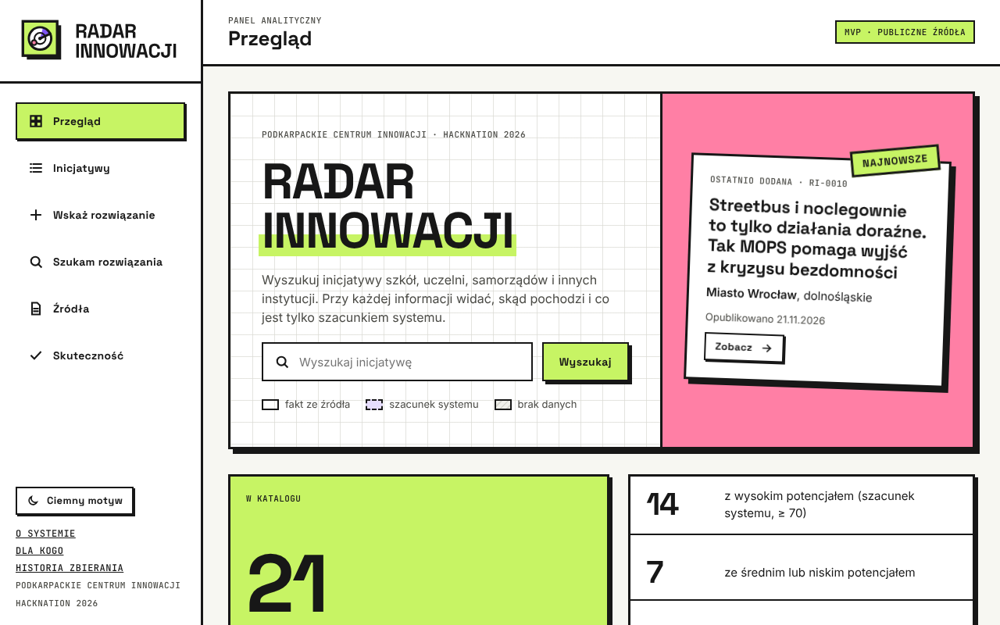
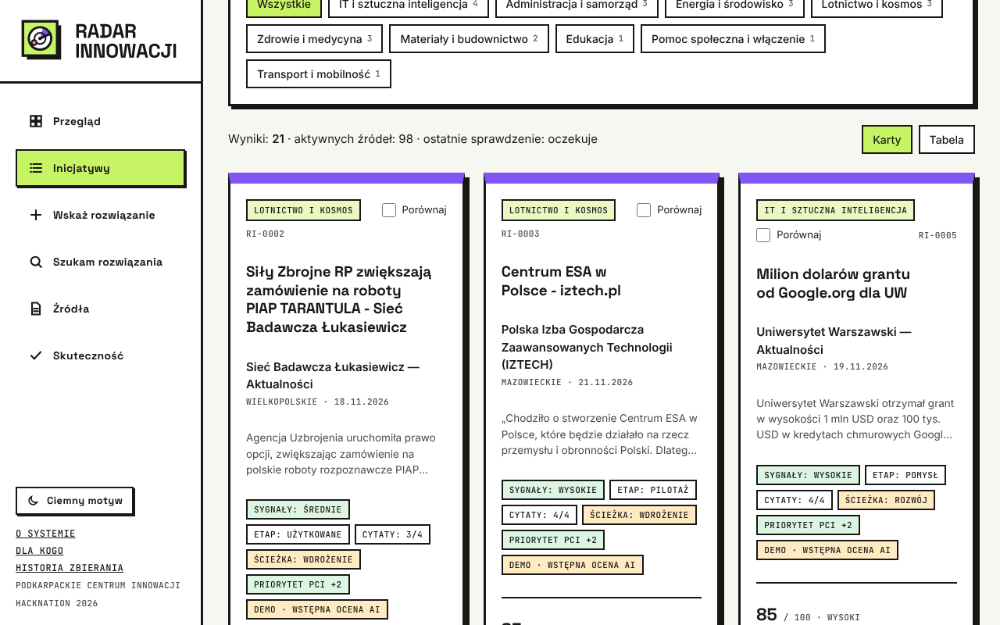
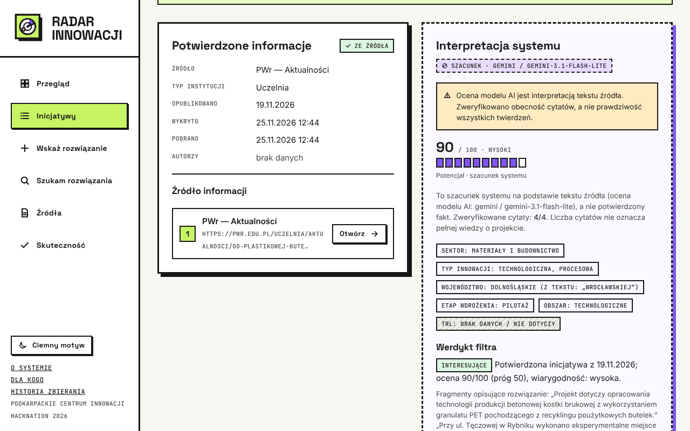
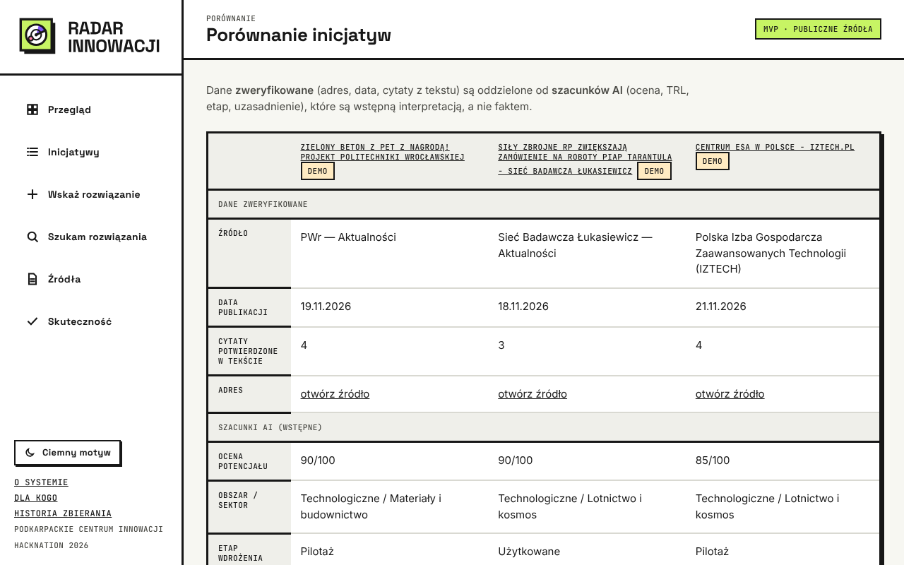
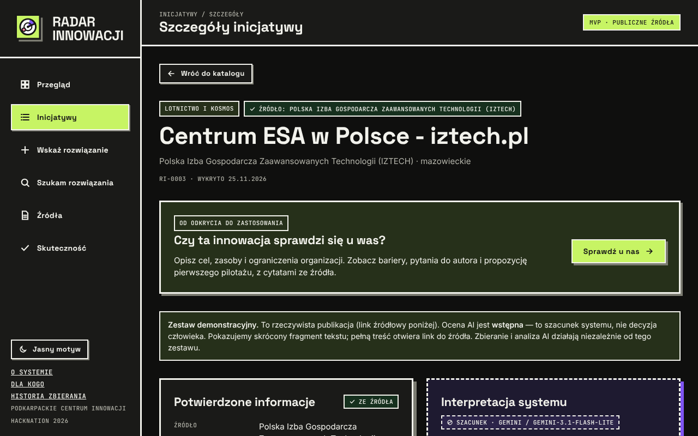

# Radar Innowacji · Innovation Radar

**An AI-assisted radar that finds innovations hidden in the news feeds of Polish public institutions — and tells you what to do with them.**

Built at **HackNation 2026** for the challenge set by the *Podkarpackie Centrum Innowacji* (PCI) · team **Zhivchiki** · Django · Gemini / Groq · [EUPL-1.2](LICENSE)

**[▶ Open the live demo](https://kseniiabondarenko0.github.io/HackNation_2026/)** — a read-only snapshot with 21 real, AI-analysed publications. No install, no login.

> The app's interface is in Polish (it was built for a Polish regional innovation centre). This README is in English; the full technical documentation in Polish is in [DOKUMENTACJA.md](DOKUMENTACJA.md).



---

## The problem

Universities, research institutes, schools and municipalities publish news about new solutions every day — a concrete made from recycled PET, a reconnaissance robot, a social-services programme that actually works. That information is scattered across hundreds of websites and disappears in the feed within a week. A regional innovation centre has no realistic way to read all of it, let alone decide which items are worth a phone call.

## What Radar Innowacji does

1. **Collects** — a background worker monitors a registry of **137 public sources** (HTML listings, RSS/Atom, sitemaps), respecting `robots.txt`, rate limits and SSRF checks. It can also discover new candidate sources on its own.
2. **Filters & analyses** — each publication goes to an LLM (Gemini, with Groq as fallback) that decides whether it describes an *existing* solution, scores its potential 0–100, classifies sector, region, maturity and TRL, and lists what information is missing.
3. **Keeps the AI honest** — every claim must be backed by a **verbatim quote** from the source; quotes are verified against the stored text and unverifiable ones are dropped. The UI visually separates *facts from the source*, *system estimates* and *missing data*.
4. **Recommends the next step** — development, technology transfer, commercialisation or deployment, and matches the innovation with organisations that need it.
5. **"Sprawdź u nas" (Would it work for us?)** — describe your organisation's goals, resources and constraints, and the AI drafts a transfer scenario: barriers, questions for the author, a pilot proposal and success metrics — again grounded in quotes. Change the conditions and recompute to see a side-by-side diff.

All of this runs on a **0 PLN budget**: free-tier LLM accounts, internal call/token caps, a reserved quota for interactive use, and SQLite.

## Screenshots

| Catalogue with filters | Initiative detail: facts vs. AI estimate |
|---|---|
|  |  |
| **Side-by-side comparison** | **Dark mode** |
|  |  |

## Features at a glance

| Page | What it does |
|---|---|
| Overview (`/`) | Counters and the latest publications |
| Initiatives (`/inicjatywy/`) | Cards or table; accent-insensitive search; filters by source, institution, region, sector, area, maturity and path |
| Initiative card (`/a/<id>/`) | Source text, publication/detection dates, verified quotes, AI score, gaps, TRL, recommended path, similar items (TF-IDF) |
| Compare (`/porownaj/`) | 2–4 initiatives side by side |
| Submit a solution (`/zglos/`) | Anyone — school, company, NGO, citizen — can point to a solution |
| Looking for a solution (`/potrzeby/`) | Needs and recipient profiles, automatically matched to innovations |
| Would it work for us? | AI transfer scenario per organisation, with cached results and diffs |
| Effectiveness (`/skutecznosc/`) | Database health, handling stages, source quality and a filter benchmark |
| JSON / CSV API | `/api/innowacje.json`, `/api/innowacje.csv`, `/api/status/` |

## Tech stack & architecture

- **Backend:** Python 3.12+, Django 5.2 LTS, SQLite in WAL mode, gunicorn + WhiteNoise
- **Collection:** `httpx`, `trafilatura`, `feedparser`, `lxml`; robots.txt, response-size limits and redirect/URL safety checks
- **AI:** Gemini (`gemini-3.1-flash-lite`) → Groq (`gpt-oss-120b`) fallback; shared daily budget, per-process rate limiting, HTTP 429 back-off, strict JSON parsing, quote verification
- **Frontend:** server-rendered Django templates, hand-written CSS (neo-brutalist design system, light/dark themes), no JS framework
- **Ops:** Docker Compose with separate `web` and `worker` services, health checks, a "demo mode" that freezes background collection for live presentations, automatic retention policy and SQLite backups
- **Quality:** 325 offline tests (no API calls), `manage.py check`, migration checks, a link-checker script

```
 public websites ──► collection (worker) ──► analysis (LLM + rules) ──► web (Django)
  137-source registry   fetch · extract · dedupe     score · classify · verify quotes   catalogue · matching · API
```

| Directory | Responsibility |
|---|---|
| `collection/` | Source registry, crawling, extraction, discovery of new sources, network safety |
| `analysis/` | LLM clients and budget, scoring, quote verification, retention, demo data, transfer scenarios |
| `matching/` | Recipient profiles, needs, TF-IDF similarity |
| `web/` | Views, templates, CSS |
| `tests/` | 325 offline tests |

## Run it locally

The demo data loads without any API key — you only need a key (free Gemini or Groq account) to analyse new publications or generate "Would it work for us?" scenarios.

**With Docker** (recommended):

```bash
cp .env.example .env          # then set DJANGO_SECRET_KEY (any long random string)
docker compose up -d --build --wait
```

Open <http://localhost:8000>. Set `DEMO_MODE=1` in `.env` to keep the background worker from fetching and analysing.

**Without Docker** (Python 3.12+):

```bash
python -m venv .venv && source .venv/bin/activate   # Windows: .venv\Scripts\Activate.ps1
pip install -r requirements.txt
export DJANGO_DEBUG=1                               # Windows: $env:DJANGO_DEBUG = '1'
python manage.py migrate
python manage.py seed_sources
python manage.py load_demo
python manage.py runserver
```

Run the collector in a second terminal with `python manage.py collect_sources`.

**Tests:** `GEMINI_API_KEY= GROQ_API_KEY= python manage.py test tests`

## The static demo

The [live demo](https://kseniiabondarenko0.github.io/HackNation_2026/) is generated from the real app: `scripts/build_static_demo.py` creates a temporary database with the demo set, renders every page with Django's test client and writes plain HTML with relative links into `docs/` (served by GitHub Pages; also opens straight from disk via `docs/index.html`). Browsing, filters by sector/view, comparisons and both themes work; free-text search, forms and AI features point to an explanation page, because they need the server.

```bash
python scripts/build_static_demo.py    # rebuilds ./docs
```

## Honest limitations

- PDFs, scans and pages that require JavaScript or login are not processed.
- The AI score is an *estimate*, not an expert assessment; verified quotes prove the text says it, not that it's true.
- The 29-example benchmark measures the rule-based filter, not LLM quality on the open web.
- SSRF protection is basic (no DNS-rebinding protection). Similarity search is TF-IDF, not a patent search.

## Team

Team **Zhivchiki** — Kseniia Bondarenko and Roma Horbach. Built at HackNation 2026 for the Podkarpackie Centrum Innowacji challenge.

Licensed under the [European Union Public Licence 1.2](LICENSE).
